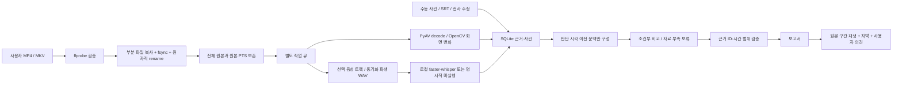

# 구조와 데이터 흐름

## 1단계 범위와 선택

단일 Python 데스크톱 프로그램입니다. PySide6 UI, PyAV/OpenCV 분석, FFmpeg 파일 처리, SQLite 저장소를 분리했습니다. 웹 서버·계정·웹 프런트엔드·게임 프로세스 후킹은 없습니다. PySide6의 QMediaPlayer/QVideoSink가 실제 원본을 재생하고 QWidget에 디코딩 프레임을 그립니다. GPU 없는 개발 환경에서도 영상 표시를 검증할 수 있도록 CPU 화면 변환을 사용합니다. 게임 중 성능에 대한 측정값은 없습니다.

## 모듈

| 모듈 | 책임 |
|---|---|
| `domain.py` | 근거·사건 자료형, 시간 검증, 당시 문맥 필터, 후속 단계용 경기 상태 머신 |
| `media.py` | ffprobe, PTS 기준 PyAV 디코딩, 화면 변화 후보, 파생 WAV, 클립 |
| `transcription.py` | 로컬 전사 인터페이스, Korean faster-whisper 어댑터, SRT 엄격 파서 |
| `analysis.py` | 판단 문맥, 조건부 비교 틀, 보고서 검증, 감도 자료 부족 처리 |
| `storage.py` | WAL SQLite, 근거 트랜잭션, 수정 revision, 작업 상태·프로필·의견 |
| `service.py` | 안전한 가져오기·삭제, 분석 파이프라인, 중복 방지 작업 큐 |
| `ui.py`, `ui_panels.py`, `ui_support.py` | 한국어 UI, 원본 재생·자막, 편집, 설정 |
| `__main__.py` | GUI/CLI 진입점, 보관함 단일 인스턴스 잠금, 환경 검사 |

## 시간축과 근거 계약

영상 내부 시각 단위는 **초**이며 `ffprobe format.start_time`을 원점으로 삼습니다. FFprobe의 트랙 시작·time_base를 저장하고 PyAV는 원본 프레임 PTS를 사용합니다. VFR을 `frame_index / 평균 FPS`로 환산하지 않습니다. 약 2Hz는 분석용 샘플링 목표이며 원본을 줄이거나 삭제하지 않습니다.

각 `Evidence`:

- `start`, `end`: 원본 사건/발화 구간.
- `cue_at`: 단서가 화면/소리에 나타난 시각.
- `available_at`: 해당 근거를 판단에 사용할 수 있는 가장 이른 시각. 문장 전체를 쓰는 전사는 발화 종료보다 빠를 수 없습니다.
- `processed_at`: 분석 또는 사용자 수정 처리 시각, UTC ISO 문자열. 시각적으로 당시 정보였는지 판단하는 필터는 이 처리 시각을 사용하지 않습니다.
- `kind`, `source`, `verified`, `speaker`, `supersedes`: 관찰/전사/화면 후보와 입력 경로, 사용자 확인, 화자 미확인, 이전 보고 정정 참조.

전술 비교기에는 판단 시각까지 **구간이 끝났고 이용 가능해진** 근거만 전달합니다. 오래된 브리핑을 현재 사실로 오용하지 않도록 사건 시작 15초 이전보다 오래된 근거는 현재 비교에서 제외합니다. 늦은 정정은 이전 시점의 문맥에 영향을 주지 않습니다. 결과·이후 장면은 보고서의 별도 필드에 저장하고 비교기 입력에는 포함하지 않습니다.

`TacticalProvider`는 교체 가능한 인터페이스입니다. 현재 네트워크 제공자는 없습니다. 기본 비교기는 확인된 수동 근거/전사에만 2개 **일반적인 조건부 비교 틀**을 제시합니다. 확인하지 않은 ASR, SRT, 화면 변화 후보만으로는 전술 조언을 생성하지 않습니다. 이 구조는 장면 이해 AI를 완성했다는 의미가 아닙니다.

모든 모델 대안은 존재하는 당시 근거 ID, 전제, 이점, 위험·비용, 다른 선택이 더 나은 조건을 가져야 합니다. 보고서의 참조와 구간은 원본 길이 내에서 검증합니다. 의미상 진실을 프로그램이 완벽히 검증하는 것은 불가능하며 현재는 사용자의 원본 확인을 전제로 합니다. 자막과 사용자 입력은 plain text로 보관하고 HTML 표시 시 escape하며 명령·프롬프트 지시로 실행하지 않습니다.

## 음성 동기화

원본 스테레오/다중 트랙은 변경하지 않습니다. 사용자가 선택한 음성 트랙만 전사용 16kHz mono PCM으로 만듭니다. FFmpeg가 컨테이너 시작 기준으로 PTS를 정규화한 뒤 `aresample=async=1:first_pts=0`으로 초기 지연과 타임스탬프 공백을 반영합니다. 1.2초 늦게 시작하는 PCM/MKV의 초기 무음 보존을 실파일로 검증했습니다. 모든 코덱·손상 파일·장기 클럭 드리프트까지 검증했다는 뜻이 아닙니다. `sync_measured=False`, `sync_error_ms=None`을 저장하며 반응 시간·음성 대응 지연 수치를 산출하지 않습니다.

## 저장·취소·복구

- 기본 보관함: Windows `%LOCALAPPDATA%/DeltaReview`, 개발 시 명시적 `--data-dir` 사용.
- 원본 가져오기 전에 저장 한도/여유 공간 확인, `.partial`에 복사 후 fsync·rename. 실패 시 앱의 불완전 사본만 지웁니다.
- DB FK cascade로 경기별 근거·사건·작업·감도 표본·의견 삭제. 사용자 외부 원본과 내보낸 사본은 삭제하지 않습니다.
- 단일 실행 잠금으로 같은 보관함을 여러 GUI/CLI가 동시에 열어 작업 복구 상태를 덮어쓰는 것을 방지합니다.
- 분석 큐는 UI와 별도의 스레드입니다. 가져오기와 클립 저장도 별도 QThread에서 실행합니다. 원본 가져오기는 이전 경기 분석이 끝나길 기다리지 않습니다. 장시간 ASR의 취소는 모델 호출/segment 경계에서 반영되며 즉시 중단을 보장하지 않습니다.
- 경기당 작업 키로 중복 등록 방지. 실패/취소/중단/부분 완료/완료 상태 구분. 앱 재시작 시 진행 중 상태는 `interrupted`로 바꾸고 사용자가 재시도합니다.
- 영상 후보 ID와 완료 체크포인트로 재시도 중 후보 중복을 방지합니다. 전사 묶음은 단일 DB 트랜잭션으로 저장합니다.
- 수정 revision과 보고서 revision이 다르면 오래된 보고서 내용을 UI에 제시하지 않습니다. 분석 도중 수정된 revision에 결과를 덮어쓰는 것도 거부합니다.
- API형 제공자 실패를 주입한 테스트에서도 원본과 이전 보고서가 남습니다. 실제 외부 API 연동은 없습니다.

## 감도와 이후 단계

프로필은 불변 기록으로 저장하고 변경 시 새 ID를 만듭니다. 구간·프로필·배율과 사용자 관찰을 저장합니다. 60fps 미만, 미확인, 반동·가림·이동·설정 불일치 표본은 유효 표본에서 제외합니다. 남은 표본도 자동 추적에 의해 검증된 것이 아니므로 수치 감도와 cm/360을 산출하지 않습니다.

2단계의 Windows 캡처/WASAPI, 종료 감지, 장치 재연결, 하드웨어 인코딩은 아직 연결되지 않았습니다. 상태 머신은 다중 신호·지속 시간·수동 종료·중복 종료 방지 규칙의 기반 코드이며 실제 게임 OCR을 수행하지 않습니다. 3단계의 게임 전용 시각·환경음 모델, 브리핑 의미 추출, 4단계의 무작위 교차 감도 비교와 추세 모델은 별도 구현·검증이 필요합니다.
