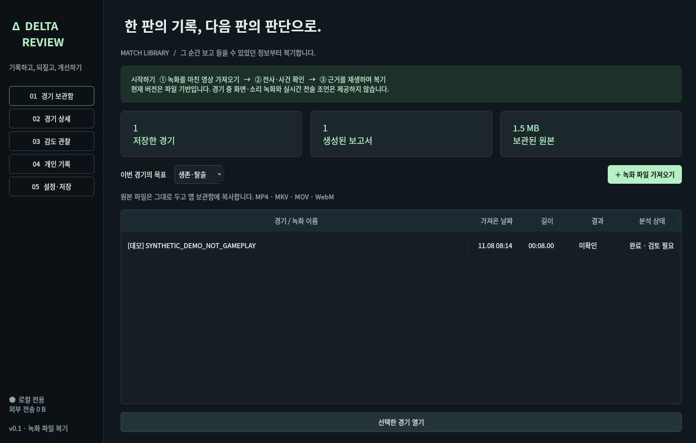
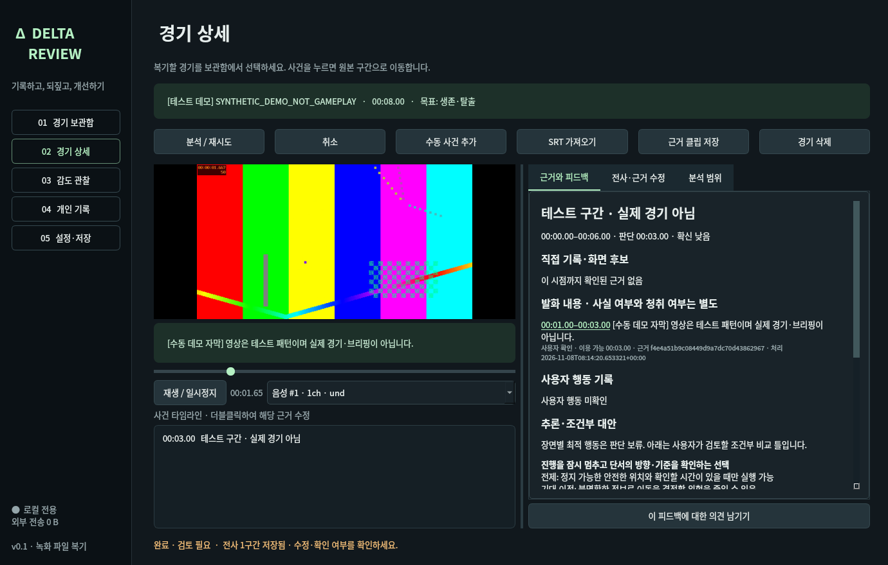

# 검증 결과

검증일: **2026-11-08 (한국 시간)**. 현재 실행 환경은 Linux이며 **Windows 실행, 실제 경기 분석 정확도, 실제 한국어 모델 추론은 검증하지 않았습니다.**

## 실행 환경 실측

- Linux x86_64, Python 3.12.14
- Intel Xeon Platinum 8573C 노출 논리 CPU 5개, 메모리 33.3GiB
- 최초 디스크 여유 약 60GiB
- 시스템 FFmpeg 7.1.5, PyAV 16.1.0, OpenCV 4.14.0.94, PySide6 6.12.0, faster-whisper 1.2.1
- GPU/VRAM·하드웨어 인코더는 미검증. Qt 검사에서 하드웨어 디코더와 실제 오디오 출력 장치를 찾지 못함. CPU로 디코딩·화면 표시 확인.

## 실행한 검사

`python -m pytest -q --junitxml=test-results/pytest.xml`: **37 passed, 0 failed, 0 skipped**, 최종 실행 5.54초. 테스트 소요 시간은 합성 영상 처리 시간이며 실제 경기 분석 소요 시간 추정치가 아닙니다.

| 검사 | 근거와 결과 |
|---|---|
| 실제 파일 처리 | FFmpeg로 생성한 4초 H.264 MP4 + 2채널 톤을 가져와 해시/바이트 동일성 확인. 120프레임 디코딩, 화면 전환 후보와 보고서 생성 |
| 원본 구간 클립 | 1~3초를 MP4로 실제 인코딩하고 ffprobe 길이 확인 |
| 음성 시간축 | PCM 음성이 1.2초 늦게 시작하는 MKV에서 트랙 오프셋 확인. 16kHz mono 파생 파일의 처음 1초는 무음, 1.5~2초에 실제 톤 존재 확인 |
| VFR | 서로 다른 프레임 간격을 갖는 MP4 생성. 원본 PTS 간격 차이와 실파일 프레임 수/분석 샘플링 확인. 생성식의 소수점 PTS 반올림으로 muxer가 한 프레임을 합칠 수 있어 실제 파일 프레임 수를 기준으로 검증 |
| 전사 인터페이스 | 실제 PCM 파생 파일을 전사 계약 테스트 제공자에 전달. 저장·구간 검증 확인. **가짜 제공자는 테스트 전용이고 앱 결과를 대체하지 않음** |
| 미래 정보 차단 | 미래 적 위치에 해당하는 근거를 비교기 입력에서 제거, 처리 시각과 이용 가능 시각 분리, 문장 끝 이전 사용 거부 |
| 정정·잘못된 전사 | 정정 시점 이전 문맥 유지, 이후 정정 반영, 미검토 전사는 전술 대안 근거에서 제외 |
| 잘못된 참조·범위 | 없는 근거 ID, 미래 근거, NaN/무한/음수/영상 밖 시각, 잘못된 SRT 거부 |
| 저장 무결성 | 디스크 부족·DB 실패·취소 시 원본 보존. 전사 배치 중 다른 경기 ID 충돌이 생기면 전체 트랜잭션 롤백 |
| 모델/API형 실패 | 테스트 제공자 예외 시 이전 보고서·원본 유지, 파생 WAV 정리. **실제 API 호출은 없음** |
| 작업·종료 상태 | 중복 분석 등록 거부, 취소 반영. 다운/관전은 종료 아님, 결과 신호 2개+3초 지속·중복 종료 방지. **화면에서 실제 종료를 감지한 검사는 아님** |
| 감도 부족 처리 | 설정/유효 표본 부족 및 가림·반동·저프레임 자료에 수치 감도 미제공 |
| Qt UI | 보관함 → 경기 선택 → 실제 프레임 디코딩·표시 → 재생 위치 진행 → 자막 → 근거 수정 → 오래된 보고서 보류 → 감도/설정 화면 확인 |
| 입력 처리 | 자막의 명령 형태 문자열을 데이터로 보관, HTML escape, 전술 입력으로 승격하지 않음 |

Qt 초기 시험에서 최소 Linux 이미지에 PipeWire 라이브러리만 있고 client 설정은 없어 오디오 초기화가 충돌했습니다. 공식 Qt 소스에서 지원 옵션을 확인해 설정이 없는 Linux에서 PulseAudio를 선택하도록 수정했습니다. 명령 샌드박스 안에서는 오디오 소켓이 차단되어 멈췄고, 승인된 실행 경로에서 UI 검사를 완료했습니다. Windows 오디오 경로는 변경하지 않았습니다.

추가 확인:

- `bash scripts/setup-linux.sh` 실제 실행·재실행 성공.
- `python -m pip check`: 의존성 충돌 없음.
- `python -m delta_review doctor`, CLI 경기 목록 확인.
- Windows x64 / CPython 3.12용 고정 의존성 dry-run 해결·휠 조회 성공. 실제 Windows 런타임 실행이나 조건부 의존성 전체 설치 검증은 아님.
- 테스트·사용자 데이터는 `.gitignore` 경로에 보관. 스크린샷은 실제 Qt 앱을 실행하여 생성한 **합성 데모** 화면.

## 측정하지 않은 항목

실제 게임 장면 탐지 정밀도/재현율, 한국어 브리핑 핵심 정보 추출, 허위 주장 비율, 사람의 전술 타당성 평가, 장기 오디오 드리프트, 수집 FPS/누락률, CPU/GPU/VRAM 부하, 게임 FPS 영향, 경기 종료~보고서 완료 시간, 모델/API 사용량·비용은 아직 측정하지 않았습니다. 외부 전송량은 구현상 0이며 외부 API를 사용하지 않습니다. 모델 추론을 수행하지 않은 것을 모델 비용 0 성능 평가로 표현하지 않습니다.

## 실제 자료 평가 절차

1. 음성 포함 허용 범위를 확인한 실제 녹화와 사용자 목표, 현재 DPI/기본/ADS/배율 감도를 확보합니다.
2. **경기 ID 단위**로 학습/개발/검증을 나눕니다. 같은 경기의 인접 클립을 양쪽에 배치하지 않습니다.
3. 사람 검토자가 단서 종류·원본 구간·이용 가능 시각·정정·불명확성을 표시합니다. 비교 대안 평가는 이후 결과를 가린 상태에서 먼저 진행합니다.
4. 자동 후보와 주석의 일치 기준/시간 허용 범위를 미리 정한 뒤 TP/FP/FN과 정밀도/재현율을 집계합니다. 현재 화면 변화 탐지와 적/교전 탐지 성능을 혼동하지 않습니다.
5. 전사와 위치·부정·정정 등 핵심 내용의 정확도를 별도 평가합니다. 발화 내용의 정확성과 게임 내 사실 여부도 분리합니다.
6. 보고서 문장마다 근거 참조가 실제 주장을 뒷받침하는지 사람이 검사해 허위/과잉 주장과 판단 보류를 구분합니다. UI의 피드백 의견 기능으로 반대 이유를 기록합니다.
7. 실제 Windows 장비에서 [확인 절차](WINDOWS_CHECKLIST.md)를 실행합니다. 이후에만 기능 상태와 정확도 수치를 갱신합니다.
